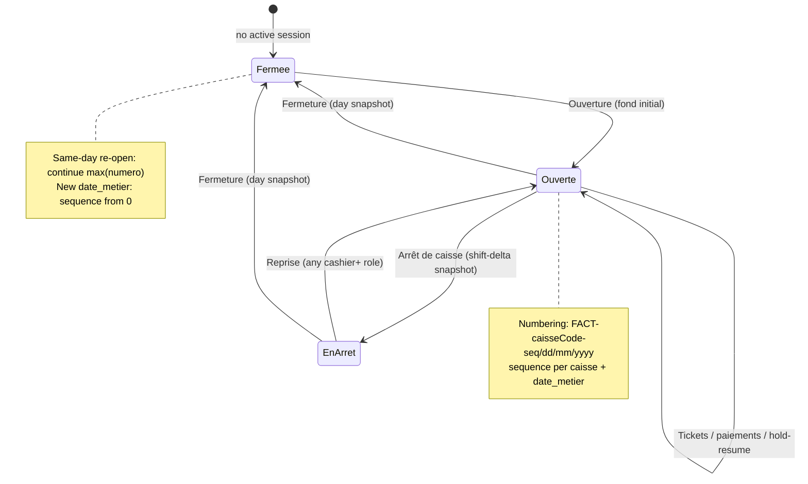
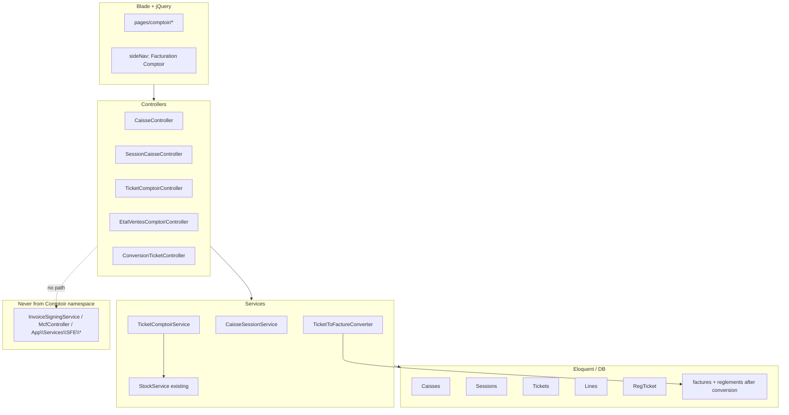
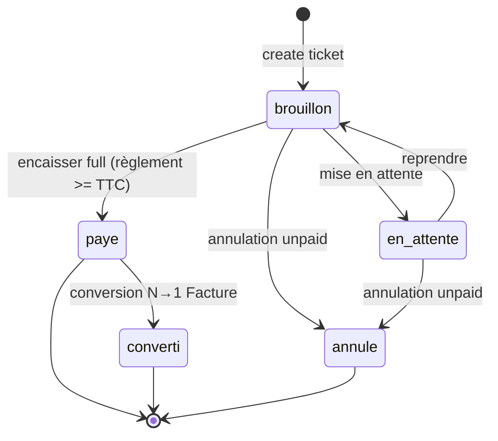
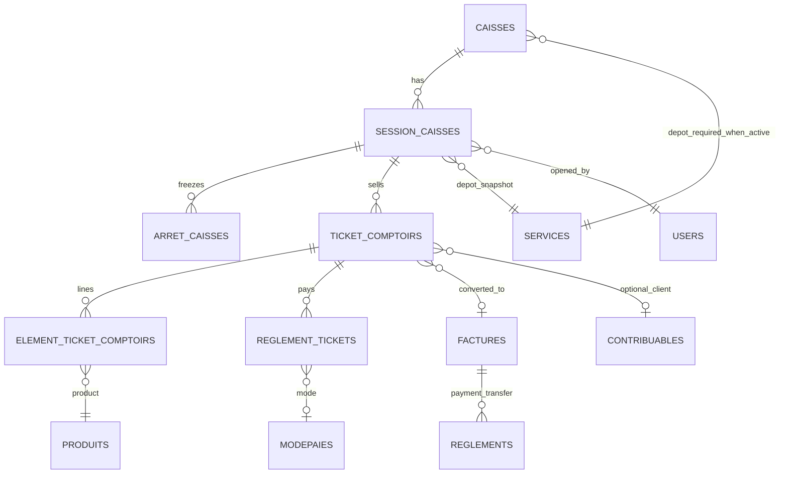
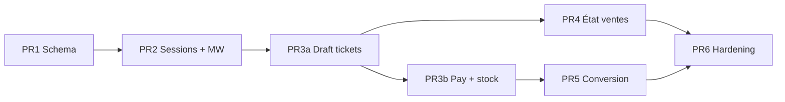

# Design Document: Facturation Comptoir (POS / Counter Sales)

| Field | Value |
|-------|--------|
| **Title** | Facturation Comptoir — Point of Sale module (non-MCF) |
| **Author** | _(to be assigned)_ |
| **Date** | 2026-08-04 |
| **Status** | Draft (rev. 4 — modern SPA-like POS: AJAX/jQuery, change/rendu, search APIs) |
| **Audience** | Senior engineers familiar with `sig-facturation` |
| **Related** | Classic client invoices (`Facture` / MCF-SFE), stock, règlements |

---

## Overview

`sig-facturation` is a Laravel 8 monolith for Benin/West Africa that already covers fiscal client invoices (`Facture` + `ElementFacture`, codes `FAC-#####/YYYY`), SFE/MCF certification via a local bridge (`app/Services/SFE/*`, `McfController`, `mcf_certifications`), stock, contribuables, modepaie, règlements, proforma, bordereau de livraison, and facture d’avoir.

The client needs a **Facturation Comptoir** (POS / counter sales) module for rapid walk-in sales at a cash register. These sales are **explicitly outside the MCF/SFE fiscal certification path**. Tickets must never call `InvoiceSigningService`, never write to `mcf_certifications`, and never set `sfe_locked_at`. Optionally, a set of paid tickets can later be **converted** into one classic `Facture` (which **is** eligible for explicit MCF certification afterward via the existing facture show / MCF UI — isolation is ticket-only, not “batch stays non-fiscal forever”).

This document defines domain model, session lifecycle (ouverture → ventes → arrêt → fermeture), numbering independent of `FAC-#####/YYYY`, stock/payment behaviour, a **modern no-reload POS shell** (Blade + heavy jQuery + JSON APIs), and an incremental PR plan.

---

## Background & Motivation

### Current state

| Capability | Where it lives today | Notes |
|------------|----------------------|--------|
| Client invoice create | `FactureController::store` | Creates with default/migration `Brouillon`, code `FAC-#####/YYYY`, decrements `produits.qte` only (no depot mouvement), optional auto SFE sign via `InvoiceSigningService` when `Entete::sfe_automatic_invoice_signing` |
| Bordereau → facture | `BordereauLivraisonController::transformToFacture` | Creates `Facture` with `statut = 'en attente'`, copies lines, **no** SFE call — preferred conversion prior art |
| Fiscal lock | `Facture::is_fiscal_locked` (`sfe_locked_at` / certifications) | Blocks update/delete (HTTP 423) |
| Payments | `Reglement` → `facture_id` only | Codes `REG-#####/YYYY`; `reste_a_payer` / `statut_paiement` derived from `reglements` |
| Stock movements | `StockService` + direct `Produit::decrement` in facture store | `StockService::sortie` **no-ops** if `serviceId` null; `reference_type` / `reference_id` on `mouvements_stock` |
| Roles | String column `users.role` | **Inconsistent values in app** (see D8): form uses `Administrateur`/`Superviseur`/`Manager`/`Seniore`/`Junior`; seeder `superviseur`; some checks `administrateur`/`superviseur`; destroy uses `admin` |
| UI | Blade under `resources/views/pages/*`, nav in `partials/sideNav.blade.php` | Not SPA |
| Default DB | `config/database.php` | **`pgsql`** (`env('DB_CONNECTION', 'pgsql')`); MySQL may exist in some deploys |

### Pain points

1. **Classic facture UX is too heavy for counter sales** — required contribuable, typefacture, modepaie, multi-step show/edit, optional MCF; cashiers need ticket + payment in seconds.
2. **MCF coupling is inappropriate for every walk-in ticket** — volume, latency, and device availability; client requirement is **no MCF on tickets**.
3. **No cash-register session model** — no fond initial, shift handoff (arrêt), or day close (fermeture) with frozen sales reports.
4. **Numbering is yearly (`FAC-#####/YYYY`)** — client wants a business-day series for comptoir that continues across shift changes within the same day.

### Motivation

Enable retail/counter operations while reusing master data (produits, stock, modepaie, contribuables) and keeping the fiscal path clean for formal invoices only.

---

## Goals & Non-Goals

### Goals

1. **Caisse lifecycle**: ouverture (with fond initial), ventes (tickets + règlements), mise en attente / reprise, arrêt de caisse (shift report), fermeture de caisse (day close + immutable snapshot).
2. **Ticket domain** fully separate from `factures` / MCF: own tables, codes, controllers, print views.
3. **Reuse** `Produit`, `ModePaie`, optional `Contribuable`, `StockService` (mandatory dépôt), role helpers.
4. **Optional conversion**: N paid tickets → 1 `Facture` (mirror of bordereau→facture), **with règlement transfer** so the facture is soldée; without auto-SFE; tickets stay non-MCF forever.
5. **État des ventes / contrôle**: list tickets, modifications under rules, convert to formal invoice.
6. **French UI labels** matching client vocabulary (Ouverture de caisse, Arrêt de caisse, Fermeture de caisse, Ticket, etc.).
7. **Incremental, mergeable PRs** on Laravel 8 / PHP 7.3+ patterns already in the repo.
8. **Modern POS sell surface**: single-page counter UI, **no full page reload** for cart/pay/hold/new ticket; JSON backend APIs; jQuery-heavy interactions (product grid/search, live calc, discount, payment modes, **rendu monnaie**, client/seller typeahead, backend stock validation).

### Non-Goals

1. **No MCF/SFE certification of tickets** (hard invariant). Converted **factures** remain eligible for **explicit** MCF cert via existing UI (not auto on conversion).
2. No full rewrite of classic facturation; no React/Vue app (POS stays Blade + jQuery).
3. No multi-tenant / multi-company architecture change.
4. No cash-drawer ESC/POS firmware or card-terminal SDK (optional barcode **input field** and thermal-friendly HTML print yes).
5. No replacement of MCF Rapport X/Z with comptoir reports (comptoir reports are **commercial**, not DGI fiscal reports).
6. No offline multi-tab queue / PWA sync in v1.
7. No v1 partial settlement of a ticket (ticket must be fully paid to reach `paye`); multi-mode split that **sums exactly to TTC** is allowed. No v1 void-after-pay (see D14, D15).

---

## Key Decisions

| # | Decision | Rationale |
|---|----------|-----------|
| D1 | **Separate tables** for caisse / session / ticket / lines / ticket payments; do **not** store tickets in `factures` | Avoids accidental SFE sign, fiscal lock, and pollution of `FAC-` series; mirrors proforma/bordereau until conversion |
| D2 | **Ticket code format (final):** `FACT-{caisseCode}-{seq}/{dd}/{mm}/{yyyy}` (e.g. `FACT-C01-001/04/08/2026`). **Unique index on `code`**. Secondary unique `(caisse_id, date_metier, numero)`. Sequence remains **per `(caisse_id, date_metier)`**; continues across arrêt **and** same-day re-ouverture (D11). `{caisseCode}` = sanitized `caisses.code` (see Numbering). | Per-caisse sequences would collide under global `UNIQUE(code)` if only day were embedded (two caisses both emit `…-001/04/08/2026`). Caisse token keeps multi-caisse (D6) safe without dropping uniqueness or globalizing the sequence. |
| D3 | **`SessionCaisse` is the unit of “open register”**; `ArretCaisse` is a shift-delta freeze; **fermeture** writes an **immutable fermeture snapshot** then ends the session | Cash control needs frozen day totals, not only live aggregates |
| D4 | **Stock decrement on ticket payment (`paye`)**, not on conversion; **`service_id` mandatory** on active caisse (and snapshotted on session); pay **aborts** if stock cannot run | `StockService::sortie` silently returns when `serviceId` is null — must never ship silent no-op sales |
| D5 | **Conversion** uses `Facture::create` + `ElementFacture::create` **like bordereau** (never `FactureController::store`); `statut = 'en attente'` then **règlements transferred** → typically `soldée`; **no** `InvoiceSigningService`. Afterward, facture **may** be MCF-certified **explicitly** via existing MCF UI | Tickets stay non-fiscal; payment KPIs stay correct; auto-sign path avoided |
| D6 | **Schema multi-caisse day 1; v1 UI one default caisse** | Cheap schema; avoids later migration churn |
| D7 | **Walk-in optional** on tickets (`contribuable_id` null + `client_libre`); conversion **requires** `contribuable_id` | Counter speed vs B2B invoice |
| D8 | **Role matrix mapped to real stored values** via `User` helpers (see Authorization). Cashiers: `Junior`, `Manager`, `Seniore`, `operateur` (+ case variants). Superviseur+: `Superviseur`, `superviseur`, `Administrateur`, `administrateur`. Treat legacy `admin` as superviseur+. | App form has no `operateur`; inventing only that role causes 403s |
| D9 | **Ticket payments in `reglement_tickets`** | `reglements.facture_id` is non-null FK to factures |
| D10 | **After conversion, tickets remain** `converti` with `facture_id`, still in caisse CA reports | Audit + shift totals |
| D11 | **Same-day re-ouverture after fermeture:** allowed; new `SessionCaisse` with same `date_metier`; **`dernier_numero` initialized from `max(numero)`** for that `(caisse_id, date_metier)` (0 if none). Never restart at 001 if tickets already exist for that day. | Avoids unique-index collision and ambiguous ticket identity after accidental/early close |
| D12 | **Conversion payment policy:** create one `Reglement` per distinct payment mode (sum amounts) from source `reglement_tickets`; map modes via `modepaie_id` / code (ESP → `Espèces` for classic UI); `observation` lists ticket codes. **Fail closed:** after lines + remises + règlements, if `abs(reste_a_payer) > 0.009` **rollback** entire conversion (French error with expected vs facture net). Success ⇒ `statut = 'soldée'`. | Prevents impayée KPI inflation, double collection, and half-applied conversions when master TVA diverges from ticket snapshots |
| D13 | **Ticket line prices are HT**; snapshot `tva_taux` on each line; `montant_ttc` formula fixed (see Money model); conversion maps ticket `remise` → facture `remise_1`, `remise_2 = 0` | Aligns with `element_factures`; master TVA changes must not rewrite history |
| D14 | **v1 full payment only** — no `partiel` statut; ticket becomes `paye` only when sum of payment lines covers TTC. **Multi-mode split allowed** if lines sum to TTC (cash + card, etc.). | POS speed; real counters often split tender |
| D15 | **v1 forbid cancel/void after `paye`** | Avoid stock reverse complexity until v1.1 |
| D16 | **Feature flag default off:** `COMPTOIR_ENABLED=false` | Incomplete module must not appear in nav |
| D17 | **Primary DB PostgreSQL**; optional partial unique index on open sessions; service-layer guard for MySQL deploys | Matches `config/database.php` default |
| D18 | **Arrêt shift-delta window** uses immutable **`stock_moved_at`** only (not `updated_at`). Predicate: `session_caisse_id` + `statut IN ('paye','converti')` + `stock_moved_at > $windowStart AND stock_moved_at <= $arrete_at`. Conversion **must not** alter `stock_moved_at`. | Conversion / any later touch bumps `updated_at` and would double-count tickets in the next shift if used as window key |
| D19 | **Espèces for cash control** = `modepaies.code = 'ESP'` via `reglement_tickets.modepaie_id` (helper `isEspeces`). Denormalized `mode` string is display-only. Conversion writes classic `Reglement.mode = 'Espèces'` for ESP to match règlement Blade dropdowns. | Seeder libelle is `Espèce`; règlement UI uses `Espèces` — string match would under-count cash |
| D20 | **POS is an AJAX-only sell surface**: one Blade shell (`pos.blade.php`); cart, hold, pay, product search, client/seller pick, discount, and stock checks use **JSON endpoints** under `module_comptoir/*` (web + session + CSRF). No `location.reload()` on success paths; print opens `window.open(print_url)`. Server remains source of truth on pay. | Counter speed; classic multi-step forms are too slow; matches existing jQuery/AJAX patterns (`wantsJson`, quick-create) without a SPA framework |
| D21 | **Change / rendu monnaie**: UI computes `rendu = max(0, montant_recu − montant_applique)` for ESP. Persist `montant` (applied to ticket), optional `montant_recu`, optional `rendu` on `reglement_tickets`. Non-ESP: `montant_recu`/`rendu` null or 0. Multi-tender lines must sum `montant` to ticket TTC within `0.009`. | Cashiers need change management; stored tender supports cash audit without inventing tips as revenue |
| D22 | **Catalog is API-searched**, not dumped in Blade for large masters. `GET produits/search`, `GET contribuables/search`, `GET meta` (modepaies, categories, sellers). Debounce ~300ms client-side. | Scalability of product master; modern POS feel |

---

## Proposed Design

### Domain concepts

```
Caisse (register) — requires service_id when active
  └── SessionCaisse (business day open period)
        ├── fond_initial, service_id (snapshot), date_metier
        ├── opened_by, opened_at, dernier_numero
        ├── statut: ouverte | en_arret | fermee
        ├── ArretCaisse[] (shift-delta snapshots, immutable)
        ├── fermeture snapshot fields (immutable once fermee)
        └── TicketComptoir[]
              ├── ElementTicketComptoir[]  (HT + tva_taux snapshot)
              ├── ReglementTicket[]
              └── optional Facture + transferred Reglement[] (after conversion)
```

**Vocabulary (FR UI)**

| Term | Meaning |
|------|---------|
| **Caisse** | Physical/logical cash register |
| **Ouverture de caisse** | Start work on a register; set fond initial; enable sales |
| **Ticket** | Counter sale document (not a fiscal facture) |
| **Mise en attente** | Hold open ticket to serve another buyer |
| **Arrêt de caisse** | Freeze **shift-delta** sales totals for handoff; sequence continues |
| **Fermeture de caisse** | Validate the day, write immutable day snapshot, close session |
| **État des ventes** | Control list / reports of tickets |

### Session lifecycle



### Session & numbering invariants

Concrete rules for implementers (`CaisseSessionService` / `TicketComptoirService`):

1. **One active session per caisse:** at most one `SessionCaisse` with `statut IN ('ouverte','en_arret')` per `caisse_id`.  
   - **PostgreSQL:** partial unique index  
     `CREATE UNIQUE INDEX session_caisses_one_open_per_caisse ON session_caisses (caisse_id) WHERE statut IN ('ouverte', 'en_arret');`  
   - **MySQL deploys:** enforce only in service layer + transaction.
2. **Sales allowed only** when session `statut = 'ouverte'` (not `en_arret`, not `fermee`).
3. **Arrêt (block drafts — no force-cancel in v1):**
   - **Hard block** if any ticket in the session has `statut IN ('brouillon','en_attente')`. French error: *« Clôturez ou annulez les tickets en cours avant l'arrêt de caisse. »*
   - No force-cancel-with-reason path in v1 (removes ambiguity).
   - Writes **immutable** `ArretCaisse` with **shift-delta** totals (see Arrêt section).
   - Sets session `statut = 'en_arret'`.
   - Does **not** change `dernier_numero` or `date_metier`.
4. **Reprise after arrêt:**
   - Any user with **cashier+** role may reprise (not limited to the user who stopped).
   - Sets `statut = 'ouverte'`.
   - Concurrent double-reprise: second call is idempotent if already `ouverte`; if two sessions somehow race, unique open index / transaction wins.
5. **Fermeture:**
   - Same draft-ticket hard block as arrêt.
   - Computes **full-session** totals since `opened_at` (all tickets of this `session_caisse_id`).
   - Writes **immutable fermeture snapshot columns** on `session_caisses` (see schema); then `statut = 'fermee'`, `closed_at`, `closed_by`.
   - Print/report for fermeture **must read snapshot columns**, not re-aggregate live tickets.
6. **Ouverture:**
   - Fail if caisse inactive or `service_id` null.
   - Fail if an open/en_arret session already exists.
   - `date_metier` default = `today()` (server date); optional override only at ouverture (then **read-only** on POS banner).
   - **`dernier_numero` init (D11):**  
     `SELECT COALESCE(MAX(numero), 0) FROM ticket_comptoirs WHERE caisse_id = ? AND date_metier = ?`  
     → assign to new session. Same calendar day after fermeture continues 048…; new day starts at 0 → first ticket 001.
   - Snapshot `session_caisses.service_id = caisses.service_id` at open (depot fixed for the session even if caisse edited later).
7. **Single-writer soft rules:** last DB write wins for ticket line edits; pay uses `lockForUpdate` on ticket row. POS does not implement distributed locks.

### Numbering

**Format (locked — D2):** `FACT-{caisseCode}-{seq}/{dd}/{mm}/{yyyy}`

| Part | Source |
|------|--------|
| `{caisseCode}` | Sanitized `caisses.code`: uppercase, spaces → nothing, only `[A-Z0-9]`; other chars stripped. Examples: `Caisse-01` → `CAISSE01`, preferred short codes `C01` → `C01`. **Must be non-empty** after sanitize (validate on caisse save). Snapshotted on ticket via live caisse at allocate time (caisse code renames are rare; do not rewrite historical ticket codes). |
| `{seq}` | `session.dernier_numero` after increment, zero-padded to **at least 3** digits; if `>= 1000`, use natural width (`1000`, not truncation) |
| `{dd}/{mm}/{yyyy}` | from `session.date_metier` |

```php
// TicketComptoirService::allocateCode(SessionCaisse $session): array{code, numero}
$session = SessionCaisse::whereKey($session->id)->lockForUpdate()->first();
// assert ouverte
$caisse = Caisse::whereKey($session->caisse_id)->first();
$caisseCode = preg_replace('/[^A-Z0-9]/', '', strtoupper(str_replace(' ', '', (string) $caisse->code)));
// assert $caisseCode !== ''
$session->dernier_numero = (int) $session->dernier_numero + 1;
$session->save();
$numero = (int) $session->dernier_numero;
$width = max(3, strlen((string) $numero));
$seq = str_pad((string) $numero, $width, '0', STR_PAD_LEFT);
$d = $session->date_metier; // Carbon date
$code = sprintf(
    'FACT-%s-%s/%s/%s/%s',
    $caisseCode,
    $seq,
    $d->format('d'),
    $d->format('m'),
    $d->format('Y')
);
// e.g. FACT-C01-001/04/08/2026  (caisse C01 and C02 can both have seq 001 the same day)
return compact('code', 'numero');
```

**Why caisse is in the code:** sequence is **per caisse + date_metier** (D6 multi-caisse). Without `{caisseCode}`, two registers both allocate `numero=1` → identical `FACT-001/04/08/2026` → `UNIQUE(code)` failure. Do **not** rely on “v1 single caisse UI” to paper over this.

**Indexes (PR1):**

- `UNIQUE(ticket_comptoirs.code)` — safe under D2 because caisse token + day disambiguate
- `UNIQUE(ticket_comptoirs.caisse_id, date_metier, numero)` — sequence integrity per register/day

**Must not collide with** `factures.code` (`FAC-#####/YYYY`) — different prefix `FACT-` vs `FAC-`.

Client oral `FACT-001/08/2026` is extended with **caisse + day**: `FACT-C01-001/04/08/2026`. UI copy: « code caisse / n° / jour / mois / année ».

### Architecture (layers)



### Ticket lifecycle & statut constants

**Canonical statut tokens** (unaccented snake, stored as-is). Implement as class constants in `App\Models\TicketComptoir` (or `App\Enums`-style PHP 7.3 class):

```php
// TicketComptoir
const STATUT_BROUILLON   = 'brouillon';
const STATUT_EN_ATTENTE  = 'en_attente';
const STATUT_PAYE        = 'paye';
const STATUT_ANNULE      = 'annule';
const STATUT_CONVERTI    = 'converti';
// v1 does NOT include 'partiel'
```

Rationale: classic app mixes accents (`soldée`, `Brouillon`, `facturé`); POS uses a closed enum to avoid query typos. UI labels may show « Payé », « Annulé », etc.



| Statut | Editable lines? | Stock? | In CA reports? |
|--------|-----------------|--------|----------------|
| `brouillon` | Yes | No | No (optional “en cours” only) |
| `en_attente` | Yes when resumed | No | No |
| `paye` | No | **Yes — at pay**; `stock_moved_at` set | Yes |
| `annule` | No | No (unpaid only in v1) | Annulations section |
| `converti` | No | Already moved | Yes, marked converted |

### Money model (ticket)

**Line prices are HT** (same commercial base as `element_factures`).

**Columns on `element_ticket_comptoirs`:**

- `prix_unitaire` — HT unit price  
- `quantite`  
- `tva_taux` — **snapshot** of `produit.tva.taux` at line add/update (decimal, e.g. 18.00)  
- `montant_ht` = `quantite * prix_unitaire` (stored or computed; store on pay for freeze)  
- `montant_tva` = `montant_ht * tva_taux / 100`  
- `montant_ttc_ligne` = `montant_ht + montant_tva`  
- **No BIC on tickets** (BIC remains facture-level if applied later on conversion as `bic_id = null` by default)

**Header:**

- `remise` — single absolute amount in FCFA (TTC reduction), default 0  
- `montant_ht` = sum of line HT  
- `montant_ttc` = `sum(montant_ttc_ligne) - remise` (clamp `>= 0`)

**Pay condition (v1 full pay only):**

```text
sum(reglement_tickets.montant) + 0.009 >= ticket.montant_ttc
```

Reject under-pay and **reject over-pay beyond 0.009** in v1 (or allow over-pay as tip — **default: reject over-pay** with clear message). No intermediate `partiel` state.

**Remise on conversion:** `facture.remise_1 = sum(ticket.remise)` (or single ticket remise when one-to-one); `facture.remise_2 = 0`.

### Payment on ticket

- One or more `ReglementTicket` rows in the **same pay transaction** (split cash/card).
- **`modepaie_id` required** on each payment line (FK to `modepaies`). Denormalized `mode` = `ModePaie.libelle` is **display-only** (print); cash control and fond math must **not** parse this string.
- ModePaie seeder today: ESP / CHQ / VIR — libelle `Espèce` (singular). Classic règlement Blade uses free-text **`Espèces`** (plural). See D19 / `isEspeces`.
- Helper (shared by arrêt, fermeture, reports):

```php
// App\Services\Comptoir\ComptoirPaymentHelper or on ReglementTicket
public static function isEspeces(ReglementTicket $rt): bool
{
    if ($rt->modepaie_id) {
        $code = optional($rt->relationLoaded('ModePaie') ? $rt->ModePaie : $rt->ModePaie()->first())->code;
        return strtoupper((string) $code) === 'ESP';
    }
    // Fallback only if legacy row lacks FK: normalize accents/plural
    $m = mb_strtolower(trim((string) $rt->mode));
    return in_array($m, ['espèce', 'especes', 'espèces', 'espece', 'cash'], true);
}
```

- **Idempotent pay:** if ticket already `paye`, return HTTP 200 + same payload/`print_url` **without** re-creating règlements or re-running stock (check `stock_moved_at` / statut under `lockForUpdate`).

### Hold / resume

- `en_attente` tickets belong to the open session; POS sidebar « Tickets en attente ».
- Resume → `brouillon` for editing; soft constraint one active editor tab.

### Arrêt de caisse (shift-delta)

**Pay-time window (locked — D18):** never use `updated_at` or statut-transition time.

```text
$windowStart = previous ArretCaisse.arrete_at for this session
               ?? session.opened_at
$arreteAt    = now() at arrêt commit

tickets_in_window =
  ticket_comptoirs WHERE
    session_caisse_id = :session
    AND statut IN ('paye', 'converti')
    AND stock_moved_at IS NOT NULL
    AND stock_moved_at >  $windowStart   -- exclusive lower bound
    AND stock_moved_at <= $arreteAt      -- inclusive upper bound
```

- **`stock_moved_at`** is set once on successful pay (same transaction as stock sorties) and is **immutable** thereafter — conversion to `converti` must **not** change it (or any pay-time field).
- CA TTC / article counts / ticket counts for the arrêt use **only** `tickets_in_window`.
- **Espèces encaissées** in the window: sum of `reglement_tickets.montant` joined to those tickets where `isEspeces($rt)` (D19) — not string match on `mode`.
- Unpaid annulations (`annule`, no `stock_moved_at`) are **out of** this window; v1 has no paid voids.

**`fond_theorique` (shift):**

```text
fond_theorique =
  (previous_fond_baseline)
  + SUM(reglement_tickets.montant for tickets_in_window where isEspeces)
  − espèces sorties caisse (v1: 0 unless cash-out added later)

previous_fond_baseline =
  first arrêt of session: session.fond_initial
  later arrêts: previous ArretCaisse.fond_declare
                (if null, previous fond_theorique)
```

**Immutable row** `arret_caisses`: `montant_ventes_ttc`, `nombre_tickets`, `montant_annulations`, `detail_modes` (json), `detail_articles` (json nullable), `fond_theorique`, `fond_declare`, `ecart`, `notes`, `arrete_at`, `user_id`.

Print: `pages/comptoir/print_arret.blade.php`.

### Fermeture de caisse (day close + snapshot)

Prefer **immutable snapshot on `session_caisses`** (no separate table required unless preferred for symmetry):

| Snapshot column | Content |
|-----------------|--------|
| `fermeture_at` | datetime (same as `closed_at` or alias) |
| `fermeture_montant_ventes_ttc` | full session CA |
| `fermeture_nombre_tickets` | count paye+converti |
| `fermeture_montant_annulations` | |
| `fermeture_detail_modes` | json |
| `fermeture_detail_articles` | json nullable |
| `fermeture_fond_theorique` | fond_initial + all session ESP règlements (`isEspeces`) − sorties |
| `montant_fermeture_declare` | counted cash |
| `fermeture_ecart` | declare − théorique |
| `notes_fermeture` | text |

After close, print **only** these columns. Ticket rows remain for audit but must not redefine fermeture print (v1.1 voids would not rewrite snapshot).

### Conversion tickets → Facture

**Hard algorithm** — copy of bordereau pattern, extended with payment transfer. **Must not** call `FactureController::store` (would auto-sign when SFE automatic is on). **Must not** inject or call `InvoiceSigningService`.

```mermaid
sequenceDiagram
    participant U as Superviseur+
    participant CV as ConversionTicketController
    participant S as TicketToFactureConverter
    participant T as ticket_comptoirs
    participant F as factures / element_factures
    participant R as reglements

    U->>CV: POST ticket_ids + contribuable_id + typefacture_id
    CV->>S: convert(ids, meta)
    S->>T: lockForUpdate tickets; assert all paye; not converti
    S->>F: Facture::create statut en attente FAC- code (tx)
    S->>F: ElementFacture lines (aggregation rules)
    S->>R: Reglement::create per mode from reglement_tickets
    S->>S: assert abs(reste_a_payer) <= 0.009 else ROLLBACK
    S->>F: statut soldée
    Note over S,F: NO InvoiceSigningService
    S->>T: statut=converti, facture_id=F.id (stock_moved_at unchanged)
    S-->>U: redirect module_ordre_facture.show
```

**Facture header:**

- `statut` initial `'en attente'` (mirror bordereau); **only** set `'soldée'` after fail-closed check passes.
- `code`: same generator style as bordereau/`FactureController` (`FAC-` + 5 digits + `/` + year) inside `DB::transaction`. **Note:** existing FAC generation has no `lockForUpdate` — pre-existing race; POS does not worsen it; optional shared helper later.
- `contribuable_id` required.
- `reference`: e.g. `Comptoir: FACT-C01-001/04/08/2026, FACT-C01-002/04/08/2026`.
- `date`: request date or today.
- `remise_1` / `remise_2` per D13.
- `bic_id` null by default (supported case: same-day convert with master data aligned to ticket snapshots; BIC not on tickets).
- `modepaie_id` from request or dominant ticket mode.
- **Do not** set `sfe_locked_at` or DGI fields.

**Line aggregation (locked):**

1. Group candidate lines by `produits_id`.
2. If all lines in a group share the **same** `prix_unitaire` (and same `tva_taux`), emit **one** `ElementFacture` with summed `quantite`.
3. Otherwise **split**: one `ElementFacture` per distinct `(produits_id, prix_unitaire, tva_taux)` (or per original ticket line if still divergent).
4. `designation` = product designation or first non-null snapshot.
5. Facture TTC uses **current** `Produit`→`tva` when computing `montant_total` / `reste_a_payer` (existing Facture accessors) — hence D12 fail-closed if master TVA drifted vs ticket `tva_taux` snapshots.

**Règlement transfer (D12) + fail-closed:**

```php
// Pseudocode inside same DB::transaction after facture + lines
$byModeLabel = []; // Reglement.mode string => amount
foreach ($tickets as $t) {
    foreach ($t->ReglementTickets as $rt) {
        $code = strtoupper((string) optional($rt->ModePaie)->code);
        // Normalize to classic règlement Blade values (Espèces plural, etc.)
        if ($code === 'ESP') {
            $modeLabel = 'Espèces';
        } elseif ($code === 'CHQ') {
            $modeLabel = 'Chèque';
        } elseif ($code === 'VIR') {
            $modeLabel = 'Virement';
        } else {
            $modeLabel = $rt->mode ?: optional($rt->ModePaie)->libelle ?: 'Espèces';
        }
        $byModeLabel[$modeLabel] = ($byModeLabel[$modeLabel] ?? 0) + (float) $rt->montant;
    }
}
foreach ($byModeLabel as $modeLabel => $montant) {
    Reglement::create([
        'code' => /* REG-#####/YYYY same as ReglementController::generateCode */,
        'date' => $facture->date,
        'mode' => $modeLabel,
        'montant' => $montant,
        'reference_paiement' => null,
        'observation' => 'Conversion comptoir: ' . implode(', ', $ticketCodes),
        'facture_id' => $facture->id,
        'users_id' => auth()->id(),
    ]);
}

$facture = $facture->fresh(['ElementFactures.Produit.tva', 'Bic', 'Reglements']);
$reste = $facture->reste_a_payer; // uses live product TVA + remises − règlements
if (abs($reste) > 0.009) {
    throw new \RuntimeException(
        'Conversion impossible : le net facture ne correspond pas aux encaissements comptoir. '
        . 'Reste calculé : ' . number_format($reste, 2, ',', ' ')
        . ' FCFA. Vérifiez les taux de TVA produits (tickets en snapshot) puis réessayez.'
    ); // transaction ROLLBACK — no facture, no reglements, tickets stay paye
}
$facture->update(['statut' => 'soldée']);
// then mark tickets converti — do NOT touch stock_moved_at
```

**No silent partial conversion.** No auto-adjust of règlements or lines beyond documented tolerance (only the existing `0.009` compare). Optional future: rounding rule ≤ 1 FCFA — **not** in v1.

**Stock:** never call stock on conversion; **`stock_moved_at` unchanged** on tickets.

**Post-conversion fiscalization:** user may open the new facture and certify via existing `mcf.certifier` / SFE flow. That is **out of scope** of converter and **allowed**.

**Acceptance tests (PR5):**

- Happy path: `reste_a_payer <= 0.009`, statut `soldée`, tickets `converti`, `stock_moved_at` unchanged.
- **Fail-closed:** mutate product TVA after pay then convert → transaction rolls back, no facture row, tickets still `paye`.
- No second stock movement; no new `McfCertification`.
- Converter must not `use App\Services\SFE\...` (CI grep / unit test).

### Stock integration

**Depot resolution:** use `$session->service_id` (snapshotted at ouverture from mandatory `caisses.service_id`). Never call `StockService::sortie` with null.

**On pay (single transaction):**

1. `TicketComptoir::lockForUpdate`.
2. If `statut === paye` → idempotent return.
3. Recompute/verify `montant_ttc`; validate payments.
4. Aggregate qty by `produits_id`; for each product, check available qty (global `produits.qte` and/or depot `stocks` row for `service_id`) **inside the same transaction**.
5. For each line: `StockService::sortie($produitId, $session->service_id, $qty, 'ticket_comptoir', $ticket->id, 'Vente comptoir '.$ticket->code)`.
6. If any sortie would be skipped (defensive: re-check service_id) → **throw**, rollback, French error *« Dépôt de stock non configuré pour cette caisse. »* / *« Stock insuffisant… »*.
7. Set `statut = paye`, **`stock_moved_at = now()`** (immutable pay-time for arrêt windows — D18), cache header amounts. Do not later clear or rewrite `stock_moved_at` on conversion.

**Do not** fall back to bare `Produit::decrement` in v1 — that diverges depot vs global stock. Classic facture behavior is weaker; POS is stricter by design.

**Pre-check + race:** two concurrent pays on different tickets for last unit: row locks on stock/product or accept second failure with stock error (document retry). Prefer locking `stocks` row for `(produit_id, service_id)` when present.

### UI structure (Blade)

New nav block in `resources/views/partials/sideNav.blade.php` under heading **COMPTOIR** (only if `config('comptoir.enabled')`):

- Session active / POS → `module_comptoir.pos`
- Tickets / État des ventes → `module_comptoir.tickets.index`
- Arrêt de caisse
- Fermeture de caisse
- Caisses (superviseur+) → `module_caisse.index`
- Conversion → `module_comptoir.conversion.index`

Views under `resources/views/pages/comptoir/`:

| View | Purpose |
|------|---------|
| `session/ouvrir.blade.php` | Fond initial, select caisse, optional date_metier |
| `pos.blade.php` | **SPA-like shell only** — markup + data-config URLs; logic in `comptoir-pos.js` |
| `tickets/index.blade.php` | État des ventes |
| `tickets/show.blade.php` | Detail |
| `tickets/print.blade.php` | Receipt — **no** SECeF / fiscal QR |
| `arret/create.blade.php` + `print_arret.blade.php` | Shift stop |
| `fermeture/create.blade.php` + `print_fermeture.blade.php` | Day close from **snapshot** |
| `conversion/index.blade.php` | Multi-select → facture |
| `caisses/index.blade.php` | Register CRUD |

**Assets:** `public/js/comptoir-pos.js`, `public/css/comptoir-pos.css` (or Mix pipeline).

### POS SPA shell (no full reload) — D20 / D22

Layout (dense, modern counter UI):

```
┌──────────────────────────────────────────────────────────────────┐
│ BANNER: Caisse | Session | date_metier (RO) | Caissier | # next  │
├───────────────┬────────────────────────────┬─────────────────────┤
│ PRODUCTS      │ CART / TICKET              │ TOTALS + META       │
│ search/barcode│ lines qty × PU HT + TVA    │ HT / TVA / Remise   │
│ category chips│ ± qty, remove line         │ TTC (large)         │
│ grid cards    │                            │ Client typeahead    │
│ Held tickets  │                            │ Walk-in name        │
│               │                            │ Seller select       │
│               │                            │ [Hold] [Pay] [New]  │
└───────────────┴────────────────────────────┴─────────────────────┘
```

**Payment modal (overlay, no navigation):** mode chips (`modepaies`), optional multi-lines summing to TTC; for ESP: **montant reçu** → **rendu monnaie**; Confirm → `POST .../payer` with optional `Idempotency-Key`; success toast + `window.open(print_url)`; reset cart for next ticket.

**Live calc (client):** mirror Money model (D13); server re-computes and rejects drift `> 0.009` on pay.

**Keyboard (recommended v1):** focus search on load; Enter adds product; F2 Pay; F3 Hold; Esc closes modal; +/- qty on selected line.

**Hard rules:** no full page reload on sell paths; CSRF via `X-CSRF-TOKEN`; French 422 messages; stock blocked before and during pay.

### Routes (named for sideNav)

```php
// ===== Facturation Comptoir (non-MCF) — behind EnsureComptoirEnabled =====
Route::middleware(['comptoir.enabled'])->group(function () {
    Route::resource('module_caisse', CaisseController::class)
        ->except(['create', 'edit']);

    Route::get('module_comptoir', [TicketComptoirController::class, 'pos'])
        ->name('module_comptoir.pos');

    // Session
    Route::post('module_comptoir/session/ouvrir', [SessionCaisseController::class, 'ouvrir'])
        ->name('module_comptoir.ouvrir');
    Route::post('module_comptoir/session/arret', [SessionCaisseController::class, 'arret'])
        ->name('module_comptoir.arret');
    Route::post('module_comptoir/session/reprise', [SessionCaisseController::class, 'reprise'])
        ->name('module_comptoir.reprise');
    Route::post('module_comptoir/session/fermeture', [SessionCaisseController::class, 'fermeture'])
        ->name('module_comptoir.fermeture');
    Route::get('module_comptoir/session/courante', [SessionCaisseController::class, 'couranteJson'])
        ->name('module_comptoir.session.courante');

    // Catalog / meta JSON (POS)
    Route::get('module_comptoir/meta', [ComptoirMetaController::class, 'meta'])
        ->name('module_comptoir.meta');
    Route::get('module_comptoir/produits/search', [ComptoirMetaController::class, 'searchProduits'])
        ->name('module_comptoir.produits.search');
    Route::get('module_comptoir/contribuables/search', [ComptoirMetaController::class, 'searchContribuables'])
        ->name('module_comptoir.contribuables.search');

    // Tickets JSON + pages
    Route::get('module_comptoir/tickets/en-attente', [TicketComptoirController::class, 'enAttente'])
        ->name('module_comptoir.tickets.en_attente');
    Route::post('module_comptoir/tickets', [TicketComptoirController::class, 'store'])
        ->name('module_comptoir.tickets.store');
    Route::put('module_comptoir/tickets/{id}', [TicketComptoirController::class, 'update'])
        ->name('module_comptoir.tickets.update');
    Route::post('module_comptoir/tickets/{id}/attente', [TicketComptoirController::class, 'mettreEnAttente'])
        ->name('module_comptoir.tickets.attente');
    Route::post('module_comptoir/tickets/{id}/reprendre', [TicketComptoirController::class, 'reprendre'])
        ->name('module_comptoir.tickets.reprendre');
    Route::post('module_comptoir/tickets/{id}/valider-stock', [TicketComptoirController::class, 'validerStock'])
        ->name('module_comptoir.tickets.valider_stock');
    Route::post('module_comptoir/tickets/{id}/payer', [TicketComptoirController::class, 'payer'])
        ->name('module_comptoir.tickets.payer');
    Route::post('module_comptoir/tickets/{id}/annuler', [TicketComptoirController::class, 'annuler'])
        ->name('module_comptoir.tickets.annuler');
    Route::get('module_comptoir/tickets', [TicketComptoirController::class, 'index'])
        ->name('module_comptoir.tickets.index');
    Route::get('module_comptoir/tickets/{id}', [TicketComptoirController::class, 'show'])
        ->name('module_comptoir.tickets.show');
    Route::get('print_ticket_comptoir/{id}', [TicketComptoirController::class, 'print'])
        ->name('print_ticket_comptoir');

    Route::get('module_comptoir/conversion', [ConversionTicketController::class, 'index'])
        ->name('module_comptoir.conversion.index');
    Route::post('module_comptoir/conversion', [ConversionTicketController::class, 'store'])
        ->name('module_comptoir.conversion.store');

    Route::get('print_arret_caisse/{id}', [SessionCaisseController::class, 'printArret'])
        ->name('print_arret_caisse');
    Route::get('print_fermeture_caisse/{id}', [SessionCaisseController::class, 'printFermeture'])
        ->name('print_fermeture_caisse');
});
```

Register middleware alias `comptoir.enabled` → `App\Http\Middleware\EnsureComptoirEnabled` in `app/Http/Kernel.php` `$routeMiddleware` (PR2).

### Authorization helpers

Do **not** invent a parallel dialect of role strings in each controller. Add on `User`:

```php
// app/Models/User.php (illustrative)
public function normalizedRole(): string
{
    return strtolower(trim((string) $this->role));
}

/** Cashier: can sell, open, arrêt, reprise (not fermeture/conversion by default). */
public function isCaissierComptoir(): bool
{
    $r = $this->normalizedRole();
    return in_array($r, [
        'junior', 'manager', 'seniore', 'séniore', 'operateur', 'opérateur',
        'superviseur', 'administrateur', 'admin',
    ], true);
}

/** Superviseur / admin: fermeture, conversion, caisse CRUD, void policies later. */
public function isSuperviseurComptoir(): bool
{
    $r = $this->normalizedRole();
    return in_array($r, ['superviseur', 'administrateur', 'admin'], true);
}
```

| Action | Required |
|--------|----------|
| POS sell, hold, pay, unpaid cancel | `isCaissierComptoir()` |
| Ouverture, arrêt, reprise | `isCaissierComptoir()` |
| Fermeture, conversion, caisse admin | `isSuperviseurComptoir()` |

Optional later: add `operateur` to the user create form (`pages/users/index.blade.php`) for clarity; **not required** if Junior/Manager act as cashiers.

### Services (new)

| Class | Responsibility |
|-------|----------------|
| `App\Services\Comptoir\CaisseSessionService` | ouvrir (D11 numero), arreter (shift-delta), reprendre, fermer (snapshot) |
| `App\Services\Comptoir\TicketComptoirService` | lines, hold, pay (stock + idempotency), unpaid cancel, numbering |
| `App\Services\Comptoir\TicketToFactureConverter` | N→1 facture + règlements; no SFE |
| `App\Services\Comptoir\ComptoirReportService` | totals windows for arrêt/fermeture/état |

### Hard invariant: isolation from MCF

Checklist (code review + CI):

- [ ] No `use App\Services\SFE` under `app/Services/Comptoir/**` or `*Comptoir*Controller.php`.
- [ ] Converter uses `Facture::create` / `ElementFacture::create` only (bordereau style), never `FactureController::store` / `app(InvoiceSigningService::class)`.
- [ ] Ticket print: no SECeF banner / fiscal QR.
- [ ] `mcf_certifications` never references ticket ids.
- [ ] PR3: pay creates zero `McfCertification`.
- [ ] PR5: convert creates zero `McfCertification` and does not load signer.
- [ ] Optional PHPUnit: `assertStringNotContainsString` on converter source, or `composer` script `rg "Services\\\\SFE" app/Services/Comptoir`.

**Post-conversion:** factures **are** eligible for SFE via existing facture/MCF screens — document in UI help text on conversion success flash.

---

## API / Interface Changes

Session-auth web routes return JSON for the POS (`Accept: application/json` / `wantsJson()`). CSRF on all mutating requests. Prefer web middleware over token `routes/api.php` so the POS shares the same login session as the rest of the app.

### Validation error shape (JSON)

```json
{
  "success": false,
  "message": "Stock insuffisant : …",
  "errors": { "field": ["…"] }
}
```

HTTP 422 validation; 403 roles; 409 illegal state (e.g. pay on `annule`).

### Meta & search (POS bootstrap)

**GET** `module_comptoir/meta` → modepaies, categories, sellers (caissiers), default caisse id, money config (tolerance `0.009`).

**GET** `module_comptoir/produits/search?q=&categorie_id=&barcode=&limit=50` → id, designation, prix_ht, tva_taux, stock_disponible, categorie_id, barcode if any.

**GET** `module_comptoir/contribuables/search?q=` → id, assujeti, ifu, telephone (typeahead).

### Session courante (POS header)

**GET** `module_comptoir/session/courante` → `module_comptoir.session.courante`

```json
{
  "success": true,
  "session": {
    "id": 3,
    "statut": "ouverte",
    "date_metier": "2026-08-04",
    "fond_initial": 10000,
    "dernier_numero": 47,
    "caisse": { "id": 1, "code": "C01", "libelle": "Caisse principale" },
    "service_id": 2,
    "opened_by": { "id": 5, "nom": "…", "prenom": "…" }
  }
}
```

`session: null` when no open/en_arret session for the selected/default caisse.

### Ticket cart sync

**POST** `module_comptoir/tickets` — create draft (optional empty lines).

**PUT** `module_comptoir/tickets/{id}` — full cart replace while `brouillon` or `en_attente`:

```json
{
  "contribuable_id": null,
  "client_libre": "Client passage",
  "user_id": 5,
  "remise": 500,
  "lignes": [
    { "produits_id": 12, "quantite": 2, "prix_unitaire": 1000, "designation": "…" }
  ]
}
```

Response: full ticket JSON with recomputed `montant_ht`, `montant_ttc`, line snapshots.

**GET** `module_comptoir/tickets/en-attente` — held tickets for current session (sidebar).

### Stock dry-run

**POST** `module_comptoir/tickets/{id}/valider-stock` → `{ "success": true }` or 422 with insufficient lines (same style as facture stock errors).

### Ticket pay

**POST** `module_comptoir/tickets/{id}/payer` (`module_comptoir.tickets.payer`)

```json
{
  "expected_ttc": 4500,
  "paiements": [
    {
      "modepaie_id": 1,
      "montant": 4500,
      "montant_recu": 5000,
      "rendu": 500,
      "reference_paiement": null
    }
  ]
}
```

Server: recompute TTC; reject if `abs(expected_ttc - server_ttc) > 0.009` or sum(paiements.montant) drift; stock sortie; set `stock_moved_at`; statut `paye`.

**200** (including idempotent re-POST when already `paye`):

```json
{
  "success": true,
  "ticket": {
    "id": 12,
    "code": "FACT-C01-003/04/08/2026",
    "statut": "paye",
    "montant_ttc": 4500,
    "stock_moved_at": "2026-08-04T10:15:00+01:00"
  },
  "print_url": "/print_ticket_comptoir/12"
}
```

### Conversion

**POST** `module_comptoir/conversion` (`module_comptoir.conversion.store`)

```json
{
  "ticket_ids": [10, 11, 12],
  "contribuable_id": 5,
  "date": "2026-08-04",
  "typefacture_id": 1,
  "modepaie_id": 1
}
```

Response redirect or JSON with `facture.id`, `facture.code` (`FAC-…`), `statut` (`soldée` if covered).

### Annuler

Only `brouillon` / `en_attente`. Paid tickets: HTTP 409 *« Ticket déjà encaissé : annulation interdite (v1). »*

---

## Data Model Changes

### ER diagram



### Tables

#### `caisses`

| Column | Type | Notes |
|--------|------|--------|
| id | bigint PK | |
| code | string unique | Prefer short slug e.g. `C01` (sanitized into ticket codes as `C01`); `Caisse-01` → `CAISSE01` |
| libelle | string | |
| service_id | FK → services **NOT NULL when active** | Enforce: app validation `required_if:active,1`; prefer NOT NULL column always for simplicity in v1 |
| active | boolean default true | |
| timestamps | | |

**v1 rule:** `service_id` **NOT NULL** on `caisses` (simplest). Cannot activate a caisse without depot.

#### `session_caisses`

| Column | Type | Notes |
|--------|------|--------|
| id | bigint PK | |
| caisse_id | FK | |
| service_id | FK → services NOT NULL | Snapshot at ouverture |
| date_metier | date | Business day for numbering |
| statut | string | `ouverte`, `en_arret`, `fermee` |
| fond_initial | decimal(15,2) | |
| dernier_numero | unsigned int default 0 | Sequence cursor |
| opened_by | FK users | |
| opened_at | datetime | |
| closed_by | FK users nullable | |
| closed_at | datetime nullable | |
| **Fermeture snapshot** | | |
| fermeture_montant_ventes_ttc | decimal nullable | Set once at close |
| fermeture_nombre_tickets | int nullable | |
| fermeture_montant_annulations | decimal nullable | |
| fermeture_detail_modes | json nullable | Use `$table->json()` |
| fermeture_detail_articles | json nullable | |
| fermeture_fond_theorique | decimal nullable | |
| montant_fermeture_declare | decimal nullable | Counted cash |
| fermeture_ecart | decimal nullable | |
| notes_ouverture | text nullable | |
| notes_fermeture | text nullable | |
| timestamps | | |

#### `arret_caisses`

| Column | Type | Notes |
|--------|------|--------|
| id | bigint PK | |
| session_caisse_id | FK | |
| user_id | FK | |
| arrete_at | datetime | |
| montant_ventes_ttc | decimal(15,2) | Shift-delta |
| nombre_tickets | int | |
| montant_annulations | decimal(15,2) default 0 | |
| detail_modes | json | |
| detail_articles | json nullable | |
| fond_theorique | decimal(15,2) | |
| fond_declare | decimal(15,2) nullable | |
| ecart | decimal(15,2) nullable | |
| notes | text nullable | |
| timestamps | | |

#### `ticket_comptoirs`

| Column | Type | Notes |
|--------|------|--------|
| id | bigint PK | |
| code | string **unique** | `FACT-C01-001/04/08/2026` (includes caisse token — D2) |
| numero | unsigned int | per caisse + date_metier sequence |
| session_caisse_id | FK | |
| caisse_id | FK | denormalized |
| date_metier | date | denormalized |
| contribuable_id | FK nullable | |
| client_libre | string nullable | |
| user_id | FK | cashier |
| statut | string | constants above |
| remise | decimal(15,2) default 0 | |
| montant_ht | decimal(15,2) default 0 | cached |
| montant_ttc | decimal(15,2) default 0 | cached; pay compares to this |
| stock_moved_at | timestamp nullable | **immutable** after pay; arrêt window key (D18); idempotency guard |
| facture_id | FK nullable → factures | conversion |
| annule_at / annule_par / motif_annulation | nullable | unpaid cancel |
| timestamps | | **Do not** use `updated_at` for cash windows |

**Unique:** `(caisse_id, date_metier, numero)` **and** `UNIQUE(code)`.

#### `element_ticket_comptoirs`

| Column | Type | Notes |
|--------|------|--------|
| id | bigint PK | |
| ticket_comptoir_id | FK cascade | |
| produits_id | FK | |
| designation | string nullable | snapshot |
| quantite | decimal(15,3) | |
| prix_unitaire | decimal(15,2) | **HT** |
| tva_taux | decimal(8,2) default 0 | **snapshot** |
| montant_ht | decimal(15,2) nullable | |
| montant_tva | decimal(15,2) nullable | |
| montant_ttc_ligne | decimal(15,2) nullable | |
| timestamps | | |

#### `reglement_tickets`

| Column | Type | Notes |
|--------|------|--------|
| id | bigint PK | |
| code | string nullable | optional `RTK-#####/YYYY` |
| ticket_comptoir_id | FK cascade | |
| date | date | |
| modepaie_id | FK **NOT NULL** (v1) | cash math joins `modepaies.code` (ESP) |
| mode | string | display libellé only; not for fond_theorique matching |
| montant | decimal(14,2) | Amount applied to ticket TTC |
| montant_recu | decimal(14,2) nullable | Tendered (ESP change management — D21) |
| rendu | decimal(14,2) nullable | Change returned; not revenue |
| reference_paiement | string nullable | |
| users_id | FK nullable | |
| timestamps | | |

### Migrations strategy

- Timestamps **after** existing `2026_08_11_*` (e.g. `2026_08_12_100000_…`).
- Prefer `$table->json()` for JSON columns (repo already uses json on MCF/SFE tables).
- Split migrations as in PR plan.
- Seed one default caisse only if a default `services` row exists; otherwise seed requires service FK from seeder data.
- `config/comptoir.php`: `'enabled' => env('COMPTOIR_ENABLED', false)`.

### Models (new)

```
app/Models/Caisse.php
app/Models/SessionCaisse.php
app/Models/ArretCaisse.php
app/Models/TicketComptoir.php
app/Models/ElementTicketComptoir.php
app/Models/ReglementTicket.php
```

Conventions: `$guarded = []`; capitalized relations (`Contribuable()`, `ElementTicketComptoirs()`).

---

## Alternatives Considered

### A1. Store POS tickets as `Facture` with `is_comptoir` flag

| Pros | Cons |
|------|------|
| Reuse print, règlements, lists | Auto-SFE on `FactureController::store`; fiscal lock; `FAC-` clash |

**Rejected.**

### A2. Tickets only in session/JSON until day close

| Pros | Cons |
|------|------|
| Fewer tables | Data loss; weak audit; multi-user fails |

**Rejected.**

### A3. Headless POS microservice

| Pros | Cons |
|------|------|
| Scale | Cost; dual auth; breaks monolith |

**Rejected.**

### A4. Reuse `FactureProforma` as ticket

| Pros | Cons |
|------|------|
| Existing line UI patterns | Proforma is commercial quote, wrong lifecycle; still adjacent to facture conversion lists; no caisse session; risk of operator confusion with MCF-bound sales path |

**Rejected** as ticket store (proforma may still be used independently).

### A5. Chosen: separate comptoir bounded context in monolith

**Accepted** — clear MCF isolation, incremental PRs, reuse stock/products/roles.

---

## Security & Privacy Considerations

| Threat | Severity | Mitigation |
|--------|----------|------------|
| Ticket path certifies MCF | **Critical** | Separate services; CI grep ban SFE imports; tests |
| Double stock (pay + convert) | **High** | Converter never stocks; `stock_moved_at` guard |
| Silent stock no-op (`service_id` null) | **High** | NOT NULL service on caisse/session; abort pay if sortie cannot run; log `error` |
| Double pay / race | **High** | `lockForUpdate`; idempotent pay if already `paye` |
| Sequence collision same-day re-open | **High** | D11 max(numero) init; unique indexes |
| Cashier closes with drafts | **Medium** | Hard block arrêt/fermeture |
| Unauthorized fermeture / conversion | **Medium** | `isSuperviseurComptoir()` |
| Mass assignment statut=paye | **Medium** | Pay only via dedicated action + FormRequest |
| PII `client_libre` | **Low** | Same retention posture as contribuables |

---

## Observability

| Signal | Approach |
|--------|----------|
| Logging | `Log::info` on ouverture, arrêt, fermeture, pay, convert, annulation (session_id, ticket code, user_id) |
| Stock failures | `Log::error` with caisse/service/produit context (no secrets) |
| User activity | Optional `UserActivity` on fermeture/conversion |
| Metrics | SQL on `ticket_comptoirs` (daily CA, cancel rate) — v1.1 dashboards |
| Ecart caisse | Flash warning on fermeture if `abs(ecart) > threshold` (config) |

No coupling to `sfe:monitor`.

**Backup:** caisse/session/ticket tables included in existing `parametres/backup-sql` and DB backups — no special path; document that fermeture snapshots are critical audit data.

---

## Rollout Plan

1. **`COMPTOIR_ENABLED=false` by default** — enable explicitly in staging/production when PR3+ is ready.
2. Middleware `EnsureComptoirEnabled` aborts 404/403 when disabled.
3. Stage: migrate → seed caisse with depot → train → single caisse prod → enable conversion.
4. **Rollback:** set env false; data retained; classic factures/MCF untouched.

---

## Open Questions

| # | Question | Status | Notes |
|---|----------|--------|-------|
| Q1 | Code format / uniqueness | **Resolved → D2** | `FACT-{caisseCode}-{seq}/{dd}/{mm}/{yyyy}` + unique `code` (multi-caisse safe) |
| Q2 | Multi-caisse | **Resolved → D6** | Schema multi; UI single first |
| Q3 | Conversion scope | **Resolved → D7/D5** | Optional; requires contribuable |
| Q4 | Stock timing | **Resolved → D4** | At pay; dépôt mandatory |
| Q5 | Who opens/closes | **Resolved → D8** | Role matrix on real values |
| Q6 | Tickets after conversion | **Resolved → D10** | Remain `converti` |
| Q7 | TVA/BIC on tickets | **Resolved → D13** | HT + tva snapshot; no BIC |
| Q8 | Night shift date_metier | **Non-blocking** | Default today at ouverture; read-only after; night team keeps until fermeture |
| Q9 | Partial payments | **Resolved → D14** | Full pay only v1 |
| Q10 | Cancel paid ticket | **Resolved → D15** | Forbidden v1 |
| Q11 | Same-day re-open | **Resolved → D11** | Continue max(numero) |
| Q12 | Conversion payment transfer | **Resolved → D12** | Create `Reglement` rows + **fail-closed** if reste ≠ 0 |
| Q15 | Multi-caisse vs UNIQUE(code) | **Resolved → D2** | Caisse token in code |
| Q16 | Arrêt window field | **Resolved → D18** | `stock_moved_at` only |
| Q17 | Espèces matching | **Resolved → D19** | `modepaies.code = ESP` |
| Q13 | Over-pay / tip on ticket | **Non-blocking** | v1 reject over-pay > 0.009 |
| Q14 | Add `operateur` to user form | **Non-blocking** | Optional UX; Junior/Manager suffice |

**Blocking for PR1:** none remaining among Q1–Q12 (all locked in Key Decisions).  
**Non-blocking:** Q8 display copy, Q13, Q14.

---

## Risks

| Risk | Severity | Mitigation |
|------|----------|------------|
| Engineers reuse `FactureController::store` for conversion | High | Converter algorithm + CI grep + PR5 tests |
| `StockService` silent no-op | High | Mandatory service_id; hard fail pay |
| Role case / synonym mismatch | Medium | `User::normalizedRole` + helper methods |
| FAC code race (pre-existing) | Low | Unchanged; document only |
| High volume ≥ 1000 tickets/day | Low | Dynamic pad width |
| Revenue double-count (comptoir CA + facture CA) | Medium | Separate reports; converted tickets tagged; finance SOP |

---

## References

| Resource | Path / symbol |
|----------|----------------|
| Facture create + optional SFE | `FactureController::store` |
| Fiscal lock | `Facture::is_fiscal_locked` |
| Règlements | `Reglement`, `ReglementController` |
| Stock silent null | `StockService::sortie` early return if `!$serviceId` |
| Conversion prior art | `BordereauLivraisonController::transformToFacture` (`en attente`, no SFE) |
| Routes | `routes/web.php` |
| SFE lifecycle | `docs/SFE_INTEGRATION_REPORT.md` |
| Nav | `partials/sideNav.blade.php` |
| User roles UI | `resources/views/pages/users/index.blade.php` |
| DB default | `config/database.php` → `pgsql` |
| Money tolerance | `0.009` in `Facture` / `ReglementController` |

---

## PR Plan

Incremental, independently reviewable PRs. Migration timestamps after `2026_08_11_*`.

### PR 1 — Schema & models (foundation)

- **Title:** `feat(comptoir): add caisse/session/ticket tables and Eloquent models`
- **Files:** migrations (caisses NOT NULL service_id; session + fermeture snapshot cols; arrets; tickets with `stock_moved_at`; lines with `tva_taux`; reglement_tickets); models; `config/comptoir.php` (`enabled` default **false**); optional `CaisseSeeder`; pgsql partial unique index migration note
- **Acceptance:** unique(`code`) with format `FACT-{caisseCode}-{seq}/{dd}/{mm}/{yyyy}`; unique(`caisse_id`,`date_metier`,`numero`); two caisses same day can both use numero=1 with distinct codes; `stock_moved_at` column present; no UI
- **Dependencies:** none

### PR 2 — Session lifecycle + middleware + role helpers

- **Title:** `feat(comptoir): session ouverture/arrêt/reprise/fermeture + feature flag middleware`
- **Files:**
  - `CaisseSessionService`, `ComptoirReportService` (shift-delta + full-session totals)
  - `SessionCaisseController`, `CaisseController`
  - `App\Http\Middleware\EnsureComptoirEnabled` + `Kernel.php` `$routeMiddleware['comptoir.enabled']`
  - `User::isCaissierComptoir` / `isSuperviseurComptoir`
  - Routes for session + caisse; views session/caisses/print stubs
  - Nav gated by config
  - **Feature tests:** one open session per caisse; arrêt blocks drafts; fermeture requires superviseur+; D11 same-day re-open continues numero; ouverture rejects null service; arrêt window uses `stock_moved_at` (converted ticket with old pay time does not re-enter next shift); `isEspeces` uses code ESP
- **Dependencies:** PR 1

### PR 3a — Ticket draft/hold + catalog APIs + modern POS shell

- **Title:** `feat(comptoir): ticket draft/hold, meta/search APIs, modern POS shell`
- **Files:** `TicketComptoirService` (create/update/hold/numbering), `ComptoirMetaController`, ticket JSON endpoints (store/update/attente/reprendre/en-attente), `pos.blade.php` layout, `comptoir-pos.css` skeleton, `comptoir-pos.js` cart UI (no pay yet), print stub unpaid watermark
- **Acceptance:** product/client search without reload; cart sync via PUT; hold sidebar; live HT/TVA/TTC/remise client calc
- **Dependencies:** PR 2

### PR 3b — Pay, stock, change management, full POS JS

- **Title:** `feat(comptoir): POS pay modal, stock validation, rendu monnaie, receipt`
- **Files:** pay + `valider-stock`, `reglement_tickets` (+ `montant_recu`/`rendu`), stock path, `stock_moved_at`, payment modal in `comptoir-pos.js`, keyboard shortcuts, print paid receipt
- **Tests:** pay moves stock; multi-tender sums to TTC; ESP rendu stored; second pay idempotent; **no** `McfCertification`; no full page reload required for happy path
- **Dependencies:** PR 3a

### PR 4 — État des ventes

- **Title:** `feat(comptoir): état des ventes listing and filters`
- **Files:** index filters, show, sideNav link
- **Dependencies:** PR 3a (3b for payé filters useful)

### PR 5 — Conversion N → Facture + règlement transfer

- **Title:** `feat(comptoir): convert paid tickets to Facture with règlement transfer, no auto-SFE`
- **Files:** `TicketToFactureConverter`, `ConversionTicketController`, views, named routes
- **Acceptance:** happy path `reste_a_payer <= 0.009` + `soldée`; **fail-closed** when TVA drift leaves reste > 0.009 (full rollback); `stock_moved_at` unchanged; no stock move; no McfCertification; no SFE imports; ESP → `Espèces` on `Reglement.mode`; FAC code via create-in-transaction (pre-existing race documented)
- **Dependencies:** PR 3b

### PR 6 — Hardening & polish

- **Title:** `chore(comptoir): report polish, CI SFE import ban, observability`
- **Files:** print CSS, optional dashboard CA, `Log::error` on stock fail, PHPUnit matrix, optional user-form `operateur` option
- **Done in tree:**
  - `tests/Unit/Comptoir/*` — TicketMoney, isolation, converter happy/fail-closed, code token
  - `scripts/check-comptoir-isolation.sh` — CI-friendly SFE import ban
  - POS barcode/Enter auto-add polish
- **Dependencies:** PR 2–5

### Merge order



---

## Appendix A — Mapping to existing code patterns

| Concern | Existing pattern | Comptoir approach |
|---------|------------------|-------------------|
| Code generation | `FAC-` unlocked year sequence | `FACT-{caisseCode}-{seq}/{dd}/{mm}/{yyyy}` + lock session row |
| Stock on sale | `Produit::decrement` only | **Mandatory** `StockService::sortie` + depot |
| Payments | `reglements.facture_id` | `reglement_tickets`; transfer on convert |
| Convert document | bordereau → `en attente` facture | tickets → `en attente` then `soldée` + `Reglement`s |
| Fiscal | auto-sign on store | **Never** from comptoir; optional later on facture |
| Roles | ad hoc strings | `User` helpers |
| Flash | `smilify` | same |
| Money tolerance | `0.009` | same |
| JSON columns | MCF/SFE migrations | `$table->json()` |
| Feature flags | none historically | `EnsureComptoirEnabled` + env |

## Appendix B — Example session day (two shifts + re-open)

1. **07:45** Junior A — Ouverture caisse `C01`, fond 10 000, `date_metier=2026-08-04`, `dernier_numero=0`.
2. **Morning** Tickets `FACT-C01-001/04/08/2026` … `FACT-C01-047/04/08/2026` (parallel caisse `C02` can sell `FACT-C02-001/04/08/2026` same day without collision).
3. **14:00** Arrêt — shift-delta via `stock_moved_at` window + ESP via `modepaie_id`; session `en_arret`.
4. **14:10** Junior B — Reprise; next ticket `FACT-C01-048/04/08/2026`.
5. **21:00** Superviseur — Fermeture; **snapshot columns** filled; `fermee`.
6. **21:30** Same-day re-open `date_metier=2026-08-04`; `dernier_numero = max(numero)` for C01 that day; continues e.g. `FACT-C01-113/04/08/2026`.
7. **Next calendar day** Ouverture `date_metier=2026-08-05` → `dernier_numero=0` → `FACT-C01-001/05/08/2026`.

---

*End of design document (rev. 3).*
